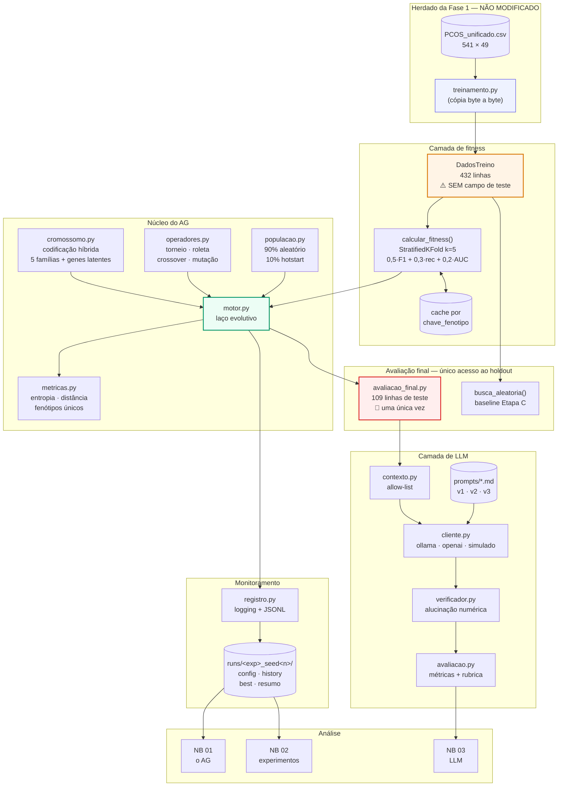
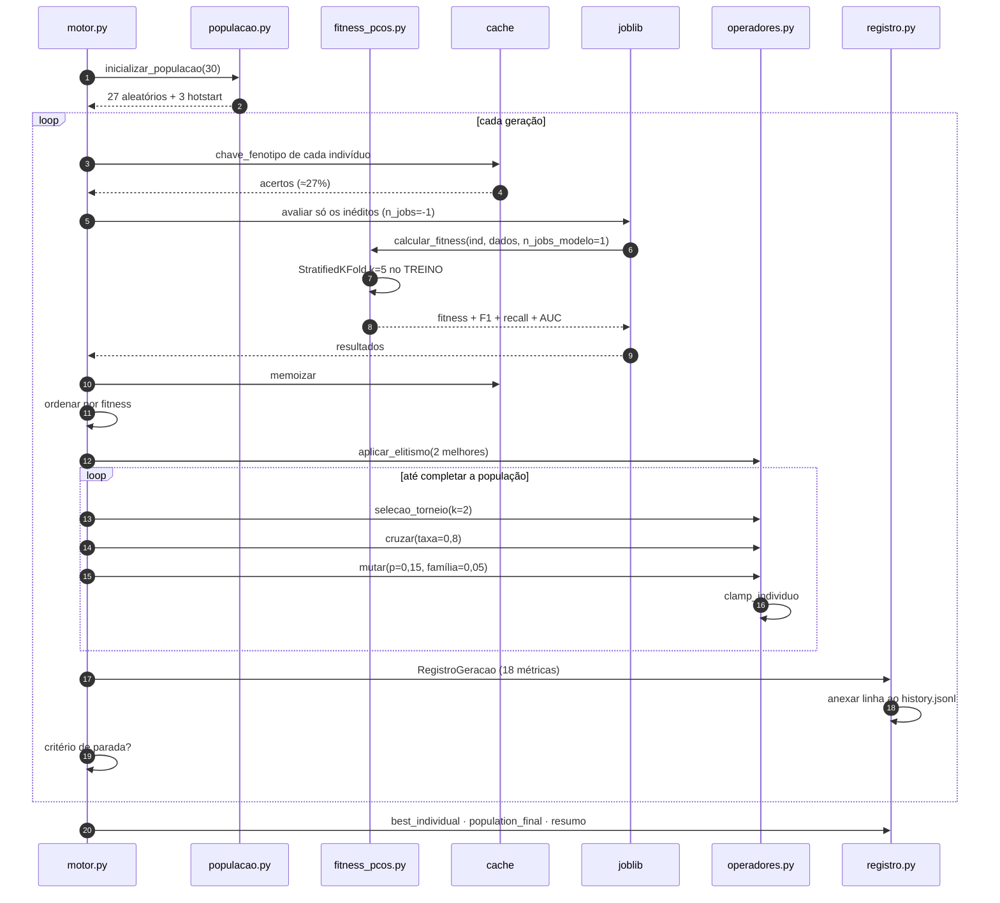
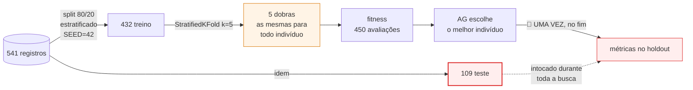
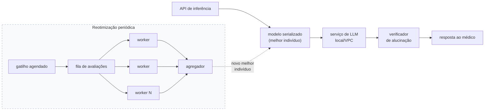

# Arquitetura da solução

**Tech Challenge Fase 2 — Projeto 1 · Otimização de modelos de diagnóstico**
Icaro Minervini Americo — RM376755 · 10IADT

Atende o requisito 2b do enunciado: *"documentar arquitetura e decisões de implementação"*.
As decisões individuais, no formato contexto → decisão → consequências, estão em
[`decisoes/`](decisoes/).

---

## 1. Visão de componentes



### A fronteira que organiza o diagrama

Repare que **`DadosTreino` e `avaliacao_final.py` estão em caixas separadas e não se tocam**.
Essa separação é a decisão de arquitetura mais importante do projeto:

- `DadosTreino` é o que o AG recebe. É um `dataclass` **sem nenhum campo** `X_teste`/`y_teste` —
  não existe atributo para um bug futuro acessar por engano.
- `avaliacao_final.py` é o único módulo que lê o holdout, e **não é importado por nenhum código
  do AG**.

A garantia é estrutural, não convencional. Um teste automatizado substitui o conjunto de teste
por um objeto que lança exceção em qualquer acesso (atributo, `len()`, indexação, iteração), e o
teste cobre tanto uma chamada isolada de fitness quanto o laço evolutivo completo.

---

## 2. Sequência de uma geração



### Por que a avaliação é feita em duas etapas (cache antes, joblib depois)

Resolver os acertos de cache **em série e antes** evita serializar para os workers do `joblib`
indivíduos cuja resposta já se conhece. Com ~27% de acerto, isso é um terço das avaliações que
nunca saem do processo principal.

### ⚠️ A armadilha de paralelismo documentada aqui

O `joblib` paraleliza **no nível do indivíduo**, e cada modelo roda com `n_jobs=1`. Combinar os
dois níveis (`joblib` com `n_jobs=-1` **e** `RandomForestClassifier(n_jobs=-1)`) cria mais
threads que núcleos — *oversubscription* — e deixa a execução **mais lenta**, não mais rápida.
É por isso que `construir_pipeline` tem `n_jobs_modelo=1` como default, e não `-1`.

---

## 3. Fluxo de dados e a regra do holdout



**Por que as mesmas 5 dobras para todos os indivíduos.** Reembaralhar as dobras entre indivíduos
introduziria ruído de amostragem como fator de confusão: dois indivíduos idênticos receberiam
fitness diferentes. Fixar as dobras remove essa variável — ao custo de permitir que o AG se
ajuste àquela partição específica, que é uma limitação declarada no Notebook 02.

**Por que CV e não um split único de validação.** Com 432 linhas, um split de validação teria
~86 linhas e variância altíssima. O AG, otimizando 450 vezes contra um alvo tão ruidoso,
otimizaria o ruído daquele split em vez do sinal.

---

## 4. Estrutura de diretórios

```
pos-tech-fiap-ia-dev-fase-2/
├── base_dados_tratada/PCOS_unificado.csv     # herdado da Fase 1
├── src/
│   ├── modelagem/treinamento.py              # ⚠️ CÓPIA INTOCADA da Fase 1
│   ├── run_ml.py                             # ⚠️ idem
│   ├── ag/
│   │   ├── cromossomo.py                     # codificação híbrida, SCHEMA, hotstart
│   │   ├── operadores.py                     # seleção, crossover, mutação
│   │   ├── populacao.py                      # inicialização, elitismo
│   │   ├── metricas.py                       # entropia, diversidade, alelos
│   │   └── motor.py                          # laço evolutivo
│   ├── fitness/
│   │   ├── fitness_pcos.py                   # CV no treino — SEM acesso ao teste
│   │   └── avaliacao_final.py                # 🔴 único acesso ao holdout
│   ├── llm/
│   │   ├── contexto.py                       # allow-list de anonimização
│   │   ├── cliente.py                        # interface fina + 3 provedores
│   │   ├── verificador.py                    # alucinação numérica
│   │   └── avaliacao.py                      # métricas + rubrica
│   ├── monitoramento/registro.py             # logging + JSONL + artefatos
│   └── experimentos/
│       ├── configuracoes.py                  # E1/E2/E3/D + hipóteses declaradas
│       ├── rodar_ag.py                       # CLI
│       └── analise.py                        # tabelas e gráficos
├── prompts/{v1,v2,v3}.md                     # templates versionados
├── notebooks/{01,02,03}.ipynb                # narrativa e análise
├── tests/                                    # 205 testes
├── runs/<experimento>_seed<n>/               # artefatos por execução
├── avaliacao_llm/                            # 45 saídas + rubrica
└── docs/
    ├── arquitetura.md                        # este arquivo
    └── decisoes/                             # ADRs
```

**Por que a separação script × notebook.** Execuções longas em notebook são frágeis: o kernel
morre, o estado se perde, e o diff do `.ipynb` fica ilegível com outputs. Os scripts de
`experimentos/` rodam e persistem em `runs/`; os notebooks **leem** e explicam. É isso que
permite reabrir a análise sem pagar o custo da busca de novo — e gravar o vídeo sem esperar
minutos a cada célula.

---

## 5. Monitoramento e logging (requisito 2a)

Duas saídas, com propósitos distintos:

| Saída | Formato | Para quê |
|---|---|---|
| Console + `logs/*.log` | texto, níveis INFO/DEBUG | acompanhamento humano da execução |
| `runs/*/history.jsonl` | uma linha JSON por geração | **fonte de dados dos gráficos** |

As 18 métricas registradas por geração:

**Convergência** — melhor fitness, fitness médio, desvio padrão
**Diversidade** — entropia do gene família, entropia média categórica, distância euclidiana
média, nº de fenótipos únicos, nº de genótipos únicos
**Alelos** — frequência de `class_weight='balanced'`, distribuição das famílias
**Eficiência** — nº de avaliações, acertos de cache, tempo por geração, tempo de avaliação,
tempo de operadores

Mais, por execução: `config.json` (todos os parâmetros **+ versões de biblioteca e
plataforma**), `best_individual.json`, `population_final.json`, `resumo.json`,
`metrics_holdout.json`.

**Por que gravar as versões de biblioteca.** Sem o ambiente registrado, um número do relatório
não é rastreável. A Fase 1 documenta que resultados em `mps` não são determinísticos entre
máquinas; aqui tudo roda em CPU e é determinístico, mas as versões ainda importam.

**Por que JSONL e escrita incremental.** Uma linha por geração, anexada na hora: uma execução
interrompida preserva o que já foi medido, e o notebook carrega direto em DataFrame.

### "Escalabilidade para variações de demanda" — a leitura honesta

O título do requisito 2 sugere autoscaling em nuvem, mas seus sub-bullets exigem apenas (a)
monitoramento e logging e (b) documentação de arquitetura — e a observação do enunciado declara
a nuvem **opcional**. Sendo um trabalho pontual sem implantação, atendo os dois sub-bullets de
forma substantiva e trato "variação de demanda" como **variação de carga computacional do AG**,
que é real e mensurável:

| Mecanismo | Efeito medido |
|---|---|
| Avaliação paralela de fitness (`joblib`) | o gargalo absoluto é o fitness, e é *embarrassingly parallel* |
| Cache por fenótipo | **26,9%** de acerto (contra 6,4% com chave de genótipo) |
| Deduplicação intra-geração | KNN tem espaço de fenótipos discreto e pequeno; colisões são frequentes |
| Ajuste dinâmico de população | implementado como critério de parada por colapso de diversidade |

**O que não foi feito, e está declarado:** não há nuvem, não há IaC, não há serviço rodando. Se
fosse para produção, o fitness é uma função *stateless* e caberia atrás de uma fila de
avaliações com workers — mas isso é desenho, não implementação.

---

## 6. Decisões de arquitetura (índice)

| ADR | Decisão |
|---|---|
| [001](decisoes/001-escopo-restrito-ao-pcos.md) | Escopo restrito ao PCOS; CNN fora da Fase 2 |
| [002](decisoes/002-codificacao-hibrida.md) | Codificação híbrida com gene de família e genes latentes |
| [003](decisoes/003-fitness-composto-cv-no-treino.md) | Fitness composto por CV no treino; holdout intocado |
| [004](decisoes/004-ag-do-zero.md) | AG implementado do zero, sem DEAP/PyGAD |
| [005](decisoes/005-torneio-em-vez-de-roleta.md) | Torneio em vez de roleta — desvio do material |
| [006](decisoes/006-mutacao-normalizada-e-familia-separada.md) | Mutação normalizada; troca de família desacoplada |
| [007](decisoes/007-cache-por-fenotipo.md) | Cache e diversidade por fenótipo, não genótipo |
| [008](decisoes/008-llm-local-e-allow-list.md) | LLM local por padrão; anonimização por allow-list |
| [009](decisoes/009-scripts-da-fase-1-intocados.md) | Scripts da Fase 1 copiados sem alteração |

---

## 7. Se fosse para produção (não implementado)



**Marcado como não implementado de propósito.** O que torna esse desenho plausível é que o
fitness já é uma função *stateless* e determinística — ela cabe num worker sem adaptação. O que
falta é tudo o resto: provisionamento, observabilidade, versionamento de modelo, validação
clínica. Documentar o desenho atende "documentar arquitetura"; fingir que está implementado não
atenderia nada.
